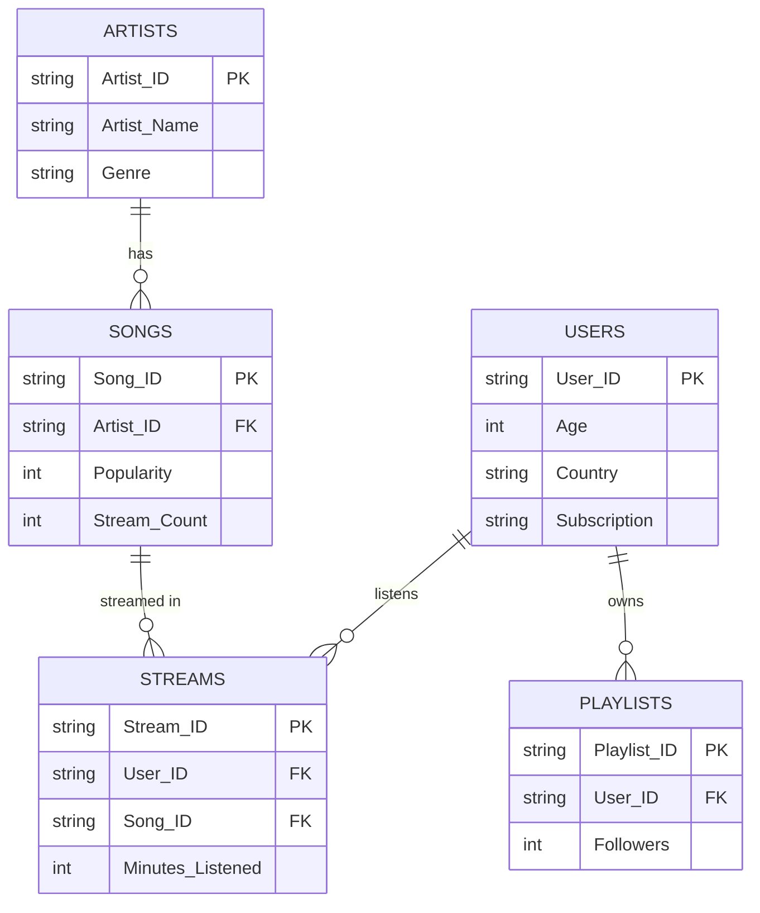
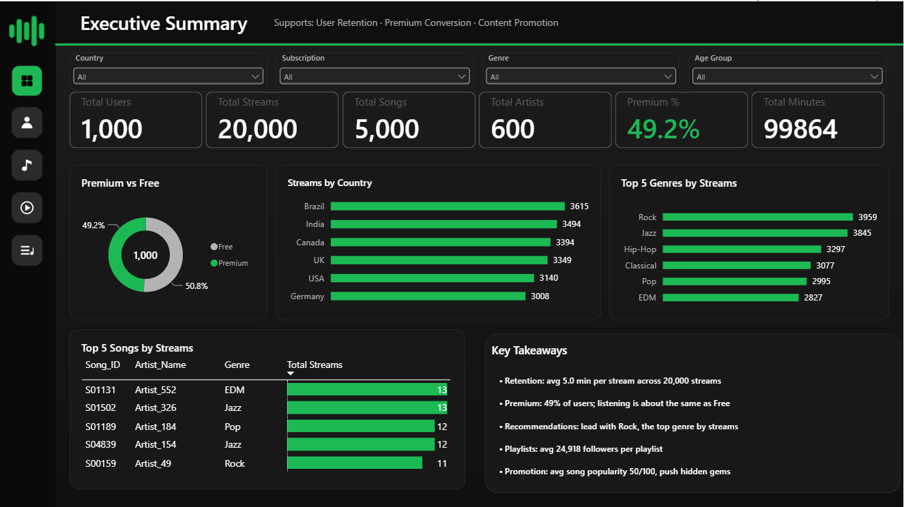
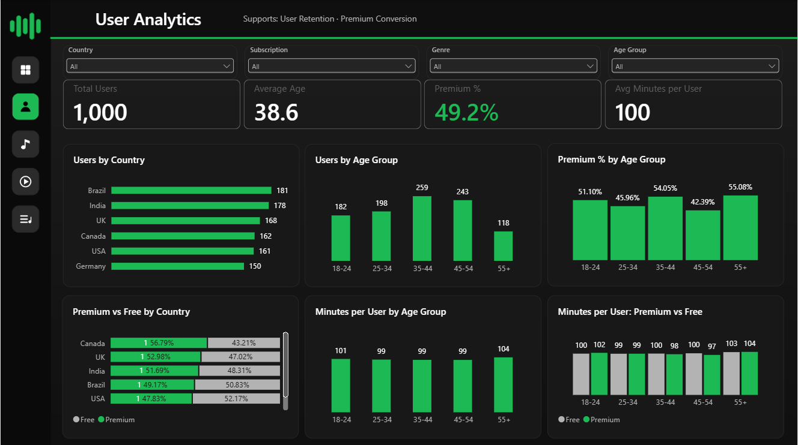
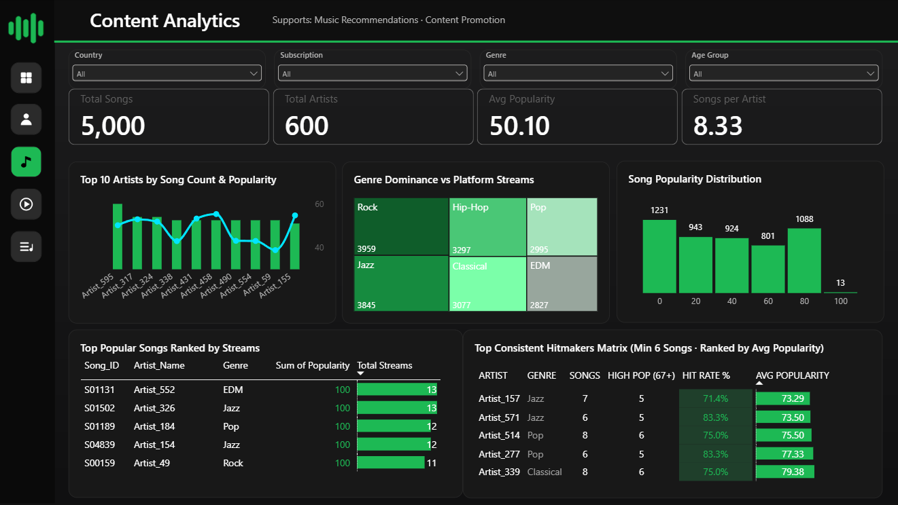
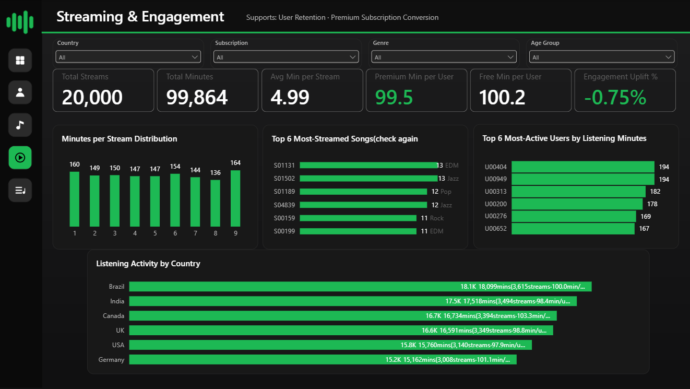
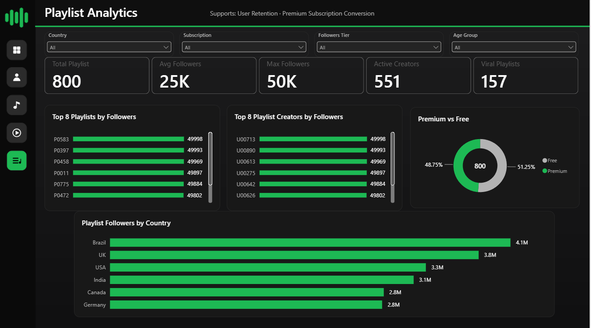
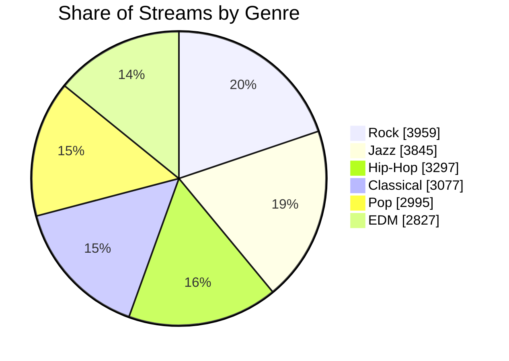

<div align="center">

# 🎧 Spotify User Engagement, Content Performance & Streaming Analytics

**An end-to-end data analytics capstone on a Spotify-style simulated dataset: Python cleaning & EDA → Power BI 5-page dashboard → business recommendations**


[📊 Dashboard](#-dashboard-tour) · [🔑 Key Findings](#-key-findings) · [❓ 21 Questions](#-answers-to-the-21-business-questions) · [💡 Recommendations](#-business-recommendations) · [📁 Repo Structure](#-repository-structure) · [🚀 Run It](#-how-to-run)

</div>

---

> ⚠️ **Data disclaimer:** This project uses a **simulated, Spotify-style practice dataset** created for a learning capstone. It is **not real Spotify data**, and this project is **not affiliated with or endorsed by Spotify**. Because the data is simulated, most distributions are close to uniform, so findings show the *analysis workflow* and should not be read as real-world Spotify insights.

## 📌 Project at a Glance

| 👥 Users | 🎵 Songs | 🎤 Artists | ▶️ Streams | ⏱️ Minutes Listened | 💚 Premium |
|:---:|:---:|:---:|:---:|:---:|:---:|
| **1,000** | **5,000** | **600** | **20,000** | **99,864** | **49.2%** |

**Business context:** As a data analyst at a Spotify-style streaming company, the goal is to understand listening behaviour, artist popularity, song performance, playlist engagement and streaming trends, to improve **retention, recommendations, playlist strategy, Premium conversion and content promotion.**

> 🎯 **Headline insight:** Premium users do **not** listen more than Free users (99.5 vs 100.2 min/user, −0.75%, Welch t-test p = 0.63). Premium conversion should therefore be sold on **Premium-only features**, targeted at the lowest-adoption segments.

---

## 🧭 Table of Contents

- [Objectives](#-objectives)
- [Tech Stack](#-tech-stack)
- [Dataset & Data Model](#-dataset--data-model)
- [Data Cleaning](#-data-cleaning)
- [Dashboard Tour](#-dashboard-tour)
- [Key Findings](#-key-findings)
- [Answers to the 21 Business Questions](#-answers-to-the-21-business-questions)
- [Business Recommendations](#-business-recommendations)
- [Limitations & Next Steps](#-limitations--next-steps)
- [Repository Structure](#-repository-structure)
- [How to Run](#-how-to-run)
- [Author](#-author)

---

## 🎯 Objectives

1. Analyse user listening behaviour
2. Identify top-performing artists and songs
3. Evaluate playlist effectiveness
4. Compare Premium and Free user engagement
5. Recommend ways to increase streaming activity

---

## 🛠 Tech Stack

| Stage | Tools |
|---|---|
| Data cleaning & EDA | Python, pandas, matplotlib, seaborn, Jupyter |
| Data storage | Excel (`.xlsx`) raw + cleaned workbooks |
| Data modelling & KPIs | Power BI, DAX measures |
| Dashboard | Power BI (5 interactive pages with slicers) |
| Reporting | PDF project report + PowerPoint presentation |

---

## 🗂 Dataset & Data Model

Five related tables in one Excel workbook. *(Simulated practice data, not real Spotify data.)*

| Table | Rows | Columns | Notes |
|---|---:|---|---|
| **Users** | 1,000 | User_ID, Age, Country, Subscription | Ages 18–59, 6 countries, Free/Premium |
| **Artists** | 600 | Artist_ID, Artist_Name, Genre | 6 genres: Rock, Jazz, Hip-Hop, Classical, Pop, EDM |
| **Songs** | 5,000 | Song_ID, Artist_ID, Popularity, Stream_Count | `Stream_Count` added during cleaning |
| **Playlists** | 800 | Playlist_ID, User_ID, Followers | 551 distinct creators |
| **Streams** | 20,000 | Stream_ID, User_ID, Song_ID, Minutes_Listened | 1–9 minutes per stream |



---

## 🧹 Data Cleaning

Done in [`01_data_cleaning.ipynb`](notebooks/01_data_cleaning.ipynb).

| Check | Action | Result |
|---|---|---|
| Duplicate records | Checked ID columns in every table | 0 duplicates |
| Missing values | Inspected with `.info()` | 0 missing |
| Invalid IDs | Verified every foreign key has a parent | 0 orphan keys |
| Data types | IDs as text; Age, Followers, Minutes as integers | ✅ Consistent |
| Text standardisation | Stripped whitespace in columns, IDs, names, genres | 6 countries, 6 genres, 2 subscription values |
| Stream counts | Counted streams per song → `Stream_Count` | Total = 20,000 |

<details>
<summary><b>🔎 Derived field: how song popularity was calculated (click to expand)</b></summary>

<br>

Popularity was **recalculated from streaming activity**: each song's `Stream_Count` was converted to a percentile rank and scaled to **1–100** (ties share an average rank; results rounded and clipped to 1–100).

**Consequences**
- Popularity and streams move together by design.
- "Top popular songs" and "consistent hit-makers" describe *streaming performance*.
- 79 songs (1.6%) have no streams and sit at the bottom of the scale.

</details>

---

## 📊 Dashboard Tour

The Power BI file [`Spotify_dashboard.pbix`](dashboard/Spotify_dashboard.pbix) has **5 pages**, each with slicers (country, subscription, age group, genre / follower tier).

> 💡 Save your dashboard screenshots in the `images/` folder using the names below and they will show up automatically.

<details open>
<summary><b>1️⃣ Executive Summary</b>: KPIs, Premium split, streams by country, top genres & songs</summary>

<br>



Supports: *User Retention · Premium Conversion · Content Promotion*

</details>

<details>
<summary><b>2️⃣ User Analytics</b>: users by country/age, Premium share, minutes per user</summary>

<br>



Supports: *User Retention · Premium Conversion*

</details>

<details>
<summary><b>3️⃣ Content Analytics</b>: top artists, genre treemap, popularity, hit-makers matrix</summary>

<br>



Supports: *Music Recommendations · Content Promotion*

</details>

<details>
<summary><b>4️⃣ Streaming & Engagement</b>: minutes distribution, top songs, most active users</summary>

<br>



Supports: *User Retention · Premium Subscription Conversion*

</details>

<details>
<summary><b>5️⃣ Playlist Analytics</b>: top playlists, top creators, followers by country</summary>

<br>



Supports: *User Retention · Premium Subscription Conversion*

</details>

---

## 🔑 Key Findings

### 👥 User behaviour
- **Balanced base:** six countries each hold 15–18% of users: Brazil 181, India 178, UK 168, Canada 162, USA 161, Germany 150.
- **Average age 38.6**; the 35–54 range holds 502 users (50%). The 35–44 group is largest (259).
- **Listening is flat:** minutes per user range only 98.8 (45–54) → 103.6 (55+); by country 97.9 (USA) → 103.3 (Canada).

### 💚 Premium vs Free
- **No engagement uplift:** 99.5 vs 100.2 min/user (−0.75%, p = 0.63). Per stream: 4.96 vs 5.03 min (p = 0.07).
- **Adoption varies:** Germany 54.0% and USA 52.2% lead; Canada 43.2% and UK 47.0% trail. By age, 55+ (55.1%) and 35–44 (54.1%) lead; 45–54 (42.4%) and 25–34 (46.0%) trail.

### 🎸 Content
- **Rock (3,959 streams) and Jazz (3,845)** together drive **39% of all streams**; EDM is lowest (2,827).
- **Artist_339, Artist_277, Artist_514** are the most consistent hit-makers.
- 17 "Consistent Hitmakers" and 19 "Hidden Gems" (avg popularity ≥ 70, fewer than 8 songs).
- **Long tail:** 1,231 songs (24.6%) sit in the lowest popularity band, including 79 with zero streams.

### 🎶 Playlists
- Followers are spread evenly from 0 to 50K (avg **24,918**).
- **157 playlists (19.6%)** are "viral" (40K+ followers).
- 551 of 1,000 users (55%) own a playlist; **U00464** has the most total followers (172,859 across 4 playlists).



---

## ❓ Answers to the 21 Business Questions

<details>
<summary><b>👥 User Analysis (Q1–Q4)</b></summary>

| # | Question | Answer |
|:-:|---|---|
| 1 | Country with most users | Brazil (181 users) |
| 2 | Average age | 38.6 years (range 18–59) |
| 3 | Age group listening most | 35–44: 25,622 minutes (per-user minutes ≈ 99–104 in every group) |
| 4 | % Premium | 49.2% (492 of 1,000) |

</details>

<details>
<summary><b>🎤 Artist Analysis (Q5–Q7)</b></summary>

| # | Question | Answer |
|:-:|---|---|
| 5 | Artists with most songs | Artist_595 (20), then Artist_317 and Artist_324 (16 each) |
| 6 | Dominant genres | Rock (977 songs, 117 artists), Jazz (964, 115), Hip-Hop (842, 104) |
| 7 | Genres most popular with listeners | Rock 3,959 streams, Jazz 3,845, Hip-Hop 3,297 |

</details>

<details>
<summary><b>🎵 Song Analysis (Q8–Q10)</b></summary>

| # | Question | Answer |
|:-:|---|---|
| 8 | Top popular songs | 13 songs tie at popularity 100; S01131 and S01502 lead on streams (13 each) |
| 9 | Average popularity | 50.10 |
| 10 | Consistent high-popularity artists | Artist_339 (79.4 avg, 8 songs), Artist_277 (77.3), Artist_514 (75.5); minimum 6 songs |

</details>

<details>
<summary><b>▶️ Streaming Analysis (Q11–Q15)</b></summary>

| # | Question | Answer |
|:-:|---|---|
| 11 | Total streams | 20,000 |
| 12 | Most-streamed songs | S01131 and S01502 (13), S01189 and S04839 (12) |
| 13 | Users listening longest | U00404 and U00949 (194 min each), U00313 (182) |
| 14 | Countries with most listening | Brazil 18,099 min, India 17,518, Canada 16,734 |
| 15 | Average minutes per stream | 4.99 |

</details>

<details>
<summary><b>🎶 Playlist Analysis (Q16–Q18)</b></summary>

| # | Question | Answer |
|:-:|---|---|
| 16 | Playlists with most followers | P0583 (49,998), P0397 (49,993), P0458 (49,969) |
| 17 | What defines successful playlists | Followers only: spread evenly 0–50K (median 25,660); 157 playlists ≥ 40K; no gap by owner subscription (Free 24,986 vs Premium 24,847 avg) |
| 18 | Users with most-followed playlists | U00464 (172,859 across 4 playlists), U00271 (155,528), U00124 (136,153) |

</details>

<details>
<summary><b>💚 Subscription Analysis (Q19–Q21)</b></summary>

| # | Question | Answer |
|:-:|---|---|
| 19 | Do Premium users listen longer? | No: 99.5 vs 100.2 minutes per user (−0.75%) |
| 20 | Highest Premium adoption | Germany 54.0%, USA 52.2%, Brazil 50.8%; lowest Canada 43.2% |
| 21 | Engagement difference by subscription | Per stream: Premium 4.96 vs Free 5.03 min (−0.07); total minutes 48,945 vs 50,919 |

</details>

---

## 💡 Business Recommendations

| Goal | Recommendation | Evidence |
|---|---|---|
| 💚 **Premium conversion** | Target Canada, UK, India and the 25–34 / 45–54 age groups with trial offers. Sell Premium on features (offline, no ads, audio quality), since it doesn't raise listening. | Canada 43.2%, UK 47.0%; 45–54 at 42.4%; uplift −0.75% |
| 🔁 **User retention** | Run re-engagement campaigns in lowest-engagement segments (USA 97.9, India 98.4, 45–54 at 98.8 min/user). Add date fields to measure retention over time. | Engagement flat at ≈100 min/user |
| 🎧 **Music recommendations** | Lead carousels with Rock and Jazz (39% of streams); use Hip-Hop (16.5%) as the third pillar; test EDM, which has similar popularity but the fewest streams. | Rock 3,959; Jazz 3,845; EDM 2,827 |
| 🎶 **Playlist strategy** | Feature the 157 viral playlists, partner with top creators (U00464, U00271, U00124), and prompt the 449 non-creators to "create your first playlist". | 157 playlists ≥ 40K; 551 active creators |
| 📣 **Content promotion** | Promote the 19 "Hidden Gems" and 17 consistent hit-makers; review the 79 never-streamed songs and 1,231 songs in the lowest band. | Artist_339 79.4 avg popularity |

---

## ⚠️ Limitations & Next Steps

**Limitations**
- No date column → streaming trends over time and true retention can't be measured.
- Popularity is derived from streams, so it is not an independent quality score.
- Near-uniform data → gaps between segments are small; treat most as directional, not proven.
- Playlists aren't linked to songs, so playlist success is judged only by followers and owner traits.

**Next steps**
- Add timestamps to enable trend, cohort and churn analysis.
- Add playlist–song links to learn what content makes playlists succeed.
- A/B test Premium offers for Canada, UK and India.

---

## 📁 Repository Structure

```
spotify-analytics-capstone/
│
├── 📂 data/
│   ├── raw/
│   │   └── Spotify_Dataset.xlsx
│   └── cleaned/
│       └── Spotify_Dataset_Cleaned.xlsx
│
├── 📂 notebooks/
│   ├── 01_data_cleaning.ipynb
│   └── 02_eda_analysis.ipynb
│
├── 📂 dashboard/
│   └── Spotify_dashboard.pbix
│
├── 📂 report/
│   └── Final_Project_Report_Vyshnav_P_S.pdf
│
├── 📂 presentation/
│   └── Spotify_Interactive_Presentation_Vyshnav.pptx
│
├── 📂 images/
│   └── dashboard_1_executive.png … dashboard_5_playlists.png
│
├── requirements.txt
└── README.md
```

### 📎 Quick links

| Resource | Link |
|---|---|
| 🗃 Raw data | [`data/raw/Spotify_Dataset.xlsx`](data/raw/Spotify_Dataset.xlsx) |
| ✨ Cleaned data | [`data/cleaned/Spotify_Dataset_Cleaned.xlsx`](data/cleaned/Spotify_Dataset_Cleaned.xlsx) |
| 🧹 Cleaning notebook | [`notebooks/01_data_cleaning.ipynb`](notebooks/01_data_cleaning.ipynb) |
| 📈 EDA notebook | [`notebooks/02_eda_analysis.ipynb`](notebooks/02_eda_analysis.ipynb) |
| 📊 Power BI dashboard | [`dashboard/Spotify_dashboard.pbix`](dashboard/Spotify_dashboard.pbix) |
| 📄 Project report | [`report/Final_Project_Report_Vyshnav_P_S.pdf`](report/Final_Project_Report_Vyshnav_P_S.pdf) |
| 🎤 Presentation | [`presentation/Spotify_Interactive_Presentation_Vyshnav.pptx`](presentation/Spotify_Interactive_Presentation_Vyshnav.pptx) |

---

## 🚀 How to Run

```bash
# 1. Clone the repository
git clone https://github.com/<your-username>/spotify-analytics-capstone.git
cd spotify-analytics-capstone

# 2. Install dependencies
pip install -r requirements.txt

# 3. Open the notebooks (run 01 first, then 02)
jupyter notebook
```

**Power BI dashboard:** open `dashboard/Spotify_dashboard.pbix` in [Power BI Desktop](https://powerbi.microsoft.com/desktop/) (Windows). If prompted, point the data source to `data/cleaned/Spotify_Dataset_Cleaned.xlsx` via *Transform data → Data source settings*.

---

## 👤 Author

**Vyshnav P S** · October 2026

[](https://github.com/vyshnavps07-oss)
[](https://www.linkedin.com/in/vyshnavpsuresh)

<div align="center">

⭐ If you found this project useful, consider giving it a star! ⭐

</div>
